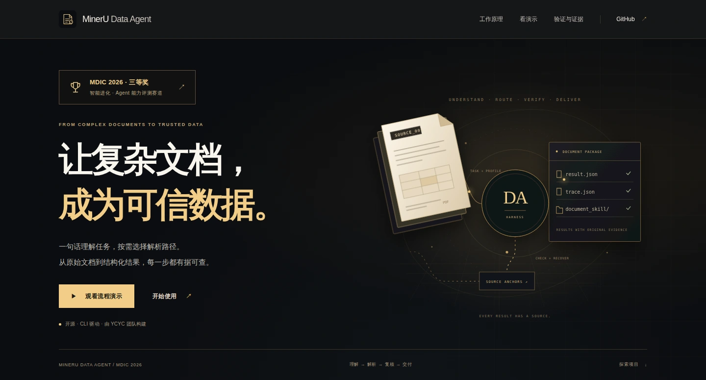
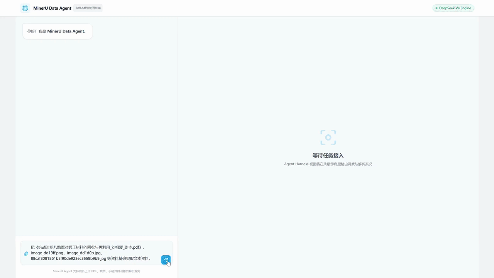
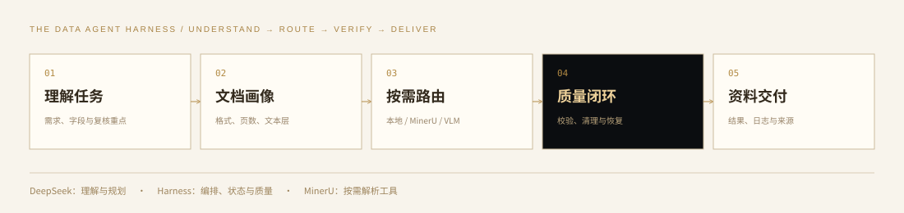

<div align="center">
  
  <h1>MinerU Data Agent · 可信数据整理</h1>
  <p><b>一句话理解任务，按需解析文档，每份结果可追溯。</b></p>
  <p>
    
    
    
    
  </p>
  <p>
    <a href="https://codezzzsleep.github.io/mineru-data-agent/">项目主页</a> ·
    <a href="https://codezzzsleep.github.io/mineru-data-agent/#demo">答辩演示</a> ·
    <a href="#快速开始">快速开始</a> ·
    <a href="#工作原理">工作原理</a> ·
    <a href="技术报告.md">技术报告</a> ·
    <a href="https://mineru.net/MDIC2026/competition">官方获奖名单</a>
  </p>
  <a href="https://codezzzsleep.github.io/mineru-data-agent/"></a>
  <p><sub>项目主页 · 工作原理、答辩流程演示与公开验证证据</sub></p>
</div>

MinerU Data Agent 是面向复杂文档处理的 **CLI-first Data Agent Harness**。它理解任务需要哪些信息，结合文件类型与质量选择解析工具，抽取和校验结果，发现异常时清理、重试或换路径，最后交付结构化数据、执行日志和可检索的资料包。主运行入口是命令行工具 `data-agent`。

**MDIC 2026「智能进化 · Agent 能力评测赛道」三等奖**，获奖团队 **YCYC**，作品《MinerU Data Agent：面向复杂文档的可审计数据智能体》，见[官方获奖名单](https://mineru.net/MDIC2026/competition)。本仓库已同步最终答辩版本，[24 个产品源码文件的 SHA-256](docs/final-defense-source-manifest.json) 可核对。

## 功能

- **自然语言交互**：`data-agent chat` 理解目标、规划步骤，调用工具并根据结果继续处理。
- **本地优先，按需升级**：原生 HTML、Word、PPT 和简单 PDF 文本层可本地提取；复杂版面、扫描件与表格按画像进入 MinerU 解析路径，必要时再做精准解析或 VLM 复核。
- **质量校验与恢复**：检查编码噪声、数字合计、结构与来源信息；异常时执行文本清理、OCR 重试或解析回退，保留每次尝试和选择依据。
- **按需读取资料**：为每份文档生成名称、描述、压缩摘要与正文引用，下游先看描述，再精读需要的内容。
- **逐本交付**：将分块或批处理结果重组回原始资料，输出 `result.json`、`summary.md`、`trace.json`、检索分块与 `document_skill/`。
- **执行可追溯**：记录工具调用、状态、恢复和来源位置；失败运行也会留下日志。

## 真实任务

答辩以整理 **142 本近代史资料**为应用场景：78 本现代参考文献、64 本影印与扫描史料，影印资料总量 **3 万余页**。

文档格式和清晰度不同，整批内容又远超单次上下文。项目采用按文档画像选择工具、逐本建立描述与摘要、按需打开正文的方式，组织可检索、可追溯的资料。这里的资料规模来自答辩场景；公开评测的统计范围见[验证与证据](#验证与证据)。

## 答辩演示

<p align="center">
  <a href="https://codezzzsleep.github.io/mineru-data-agent/#demo"></a>
  <br><sub>19 秒答辩界面流程示意 · <a href="https://codezzzsleep.github.io/mineru-data-agent/#demo">项目页内播放</a></sub>
</p>

## 快速开始

需要 **Python 3.10–3.13**。基础 HTML 样例无需模型密钥或 GPU。

```bash
git clone https://github.com/codezzzsleep/mineru-data-agent.git
cd mineru-data-agent
python -m pip install -e ".[dev]"

data-agent run \
  --input examples/cases/case_1_financial_report.html \
  --out runs/demo \
  --task "抽取财报关键字段并检查合计行" \
  --profile auto
```

运行后，每个任务目录包含：

```text
result.json                   结构化结果、质量报告与来源
summary.md                    人工可读摘要
trace.json                    执行步骤、工具调用与恢复记录
retrieval/                    可用于检索入库的分块
document_skill/               按需读取的渐进式资料包
```

**启用自然语言交互**

```bash
cp .env.example .env
# 在本机编辑 .env，填入自己的 DEEPSEEK_API_KEY
data-agent chat
```

| 运行方式 | 需要的配置 |
| --- | --- |
| 基础 HTML / Word / PPT / 简单 PDF 文本提取 | 安装项目依赖即可 |
| `chat` 自然语言交互 | 本地 `DEEPSEEK_API_KEY` |
| MinerU 精准 API | 本地 `MINERU_PRECISE_API_TOKEN` 或 `MINERU_API_TOKEN` |
| 本地 MinerU 解析复杂 PDF / 图片 | 安装 MinerU 工具链，按任务准备相应运行资源 |

真实 `.env`、本地工具配置和运行数据已从发布内容中排除，并加入 Git、Docker 和打包过滤规则。示例文件只保留占位符。

## 使用

**批处理**

```bash
data-agent batch --manifest examples/batch_manifest.json --out runs/batch_demo
```

**将页段和批处理结果合并为逐本资料包**

```bash
data-agent corpus package-sources \
  --run-root runs/batch_demo \
  --source-root /path/to/source-documents \
  --out runs/source_packages
```

**建立目录，按描述检索资料**

```bash
data-agent corpus build --root runs/source_packages
data-agent corpus search \
  --catalog runs/source_packages/corpus_catalog.json \
  --query "兵工材料与民兵武器"
```

**运行 Live tool-calling Agent**

```bash
data-agent agent-run \
  --provider deepseek \
  --input examples/cases/case_2_low_quality_ocr.html \
  --out runs/agent_live \
  --task "发现乱码后先清理，再抽取设备 B-17 的异常温度"
```

完整参数与后端说明见 [CLI 合约](docs/CLI_CONTRACT.md)和 [Live Agent 运行说明](docs/LIVE_LLM_RUNBOOK.md)。

## 工作原理

<p align="center"></p>

**DeepSeek 理解和规划；Harness 编排、校验与管理状态；MinerU 是按需调用的解析工具。** 关闭模型时，也可运行基础处理管线。

| 处理中的问题 | 项目的做法 |
| --- | --- |
| 文本层、影印件、复杂表格混在一起 | 先看文档画像，本地能提取的先直解，复杂任务再升级工具 |
| 海量原文装不进上下文 | 描述与压缩摘要用于定位，正文、表格和证据按需读取 |
| 编码噪声、数字不一致或来源缺失 | 质量门槛触发清理、重试、回退或复核，并记录处理依据 |
| 输出难以复核，分块资料失去原始归属 | 结果链接到日志和来源；页段可重新合并回逐本资料包 |

系统设计、处理机制与案例分析见根目录[技术报告](技术报告.md)。

## 验证与证据

| 验证 | 结果与范围 | 记录 |
| --- | --- | --- |
| 自动化测试 | **180 项通过**；CI 覆盖 Python 3.10 / 3.12 | [GitHub Actions](https://github.com/codezzzsleep/mineru-data-agent/actions) |
| 标注评测 | **17 个案例、45 个字段**；45/45 匹配，字段 precision / recall / F1 均为 1.0 | [逐字段指标](submission_artifacts/evaluation/evaluation_metrics.json) |
| 证据检查 | 22 条文本、11 条数字、6 条表格标注证据 | [评测报告](submission_artifacts/evaluation/evaluation_metrics.md) |
| 执行与恢复 | 财报、合同、低质量 OCR、Office、公开 PDF、分块与恢复案例 | [执行证据索引](submission_artifacts/ARTIFACTS_INDEX.md) |
| 最终版本核对 | 24 个产品 Python 源文件与答辩包一致，仅统一换行 | [发布说明与源码清单](docs/FINAL_DEFENSE_RELEASE.md) |

这些指标基于提交案例的轻量标注，包含受控样例；不等同于通用 OCR 字符或表格单元格准确率。答辩视频为界面流程示意，CLI 的真实结果、日志和恢复记录单独保存在公开案例中。

```bash
python -m pytest -q
```

适用边界和进一步评测计划见[评测策略](docs/EVALUATION_STRATEGY.md)与[基准及路线图](docs/BENCHMARK_AND_ROADMAP.md)。

## 项目结构

```text
src/mineru_data_agent/      CLI、交互式 Agent、解析路由、校验恢复与资料交付
examples/                  基础样例、任务配置与公开文档
submission_artifacts/      执行结果、trace、恢复及评测证据
tests/                     自动化测试
docs/                      设计、接口、运行、版本校验与展示页说明
scripts/                   复跑、评测、打包与 Pages 发布工具
site/                      GitHub Pages 项目展示页
技术报告.md                完整技术报告
mineru_data_agent.html      决赛答辩用界面流程示意
```

## 文档

[技术报告](技术报告.md) · [CLI 合约](docs/CLI_CONTRACT.md) · [案例说明](docs/CASE_STUDIES.md) · [接口与部署](docs/DEPLOYMENT_AND_API.md) · [最终版本说明](docs/FINAL_DEFENSE_RELEASE.md) · [项目页维护与部署](docs/WEBSITE.md)

## 维护与反馈

提交改动前运行测试；新增案例保留结果、日志、来源与标注，并说明是公开真实文档、受控样例还是故障注入。评测指标可用 `scripts/build_evaluation_report.py` 和 `scripts/build_stability_report.py` 重建。

功能建议和可复现问题可通过 [GitHub Issues](https://github.com/codezzzsleep/mineru-data-agent/issues) 反馈，请附复现步骤和脱敏日志。

## 许可证

[MIT License](LICENSE) · YCYC 团队 · MDIC 2026 智能进化 · Agent 能力评测赛道三等奖作品。
